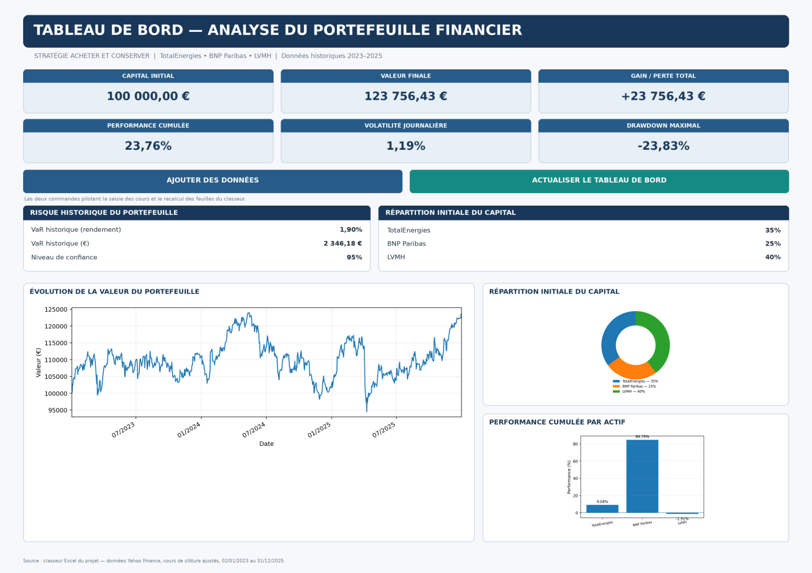
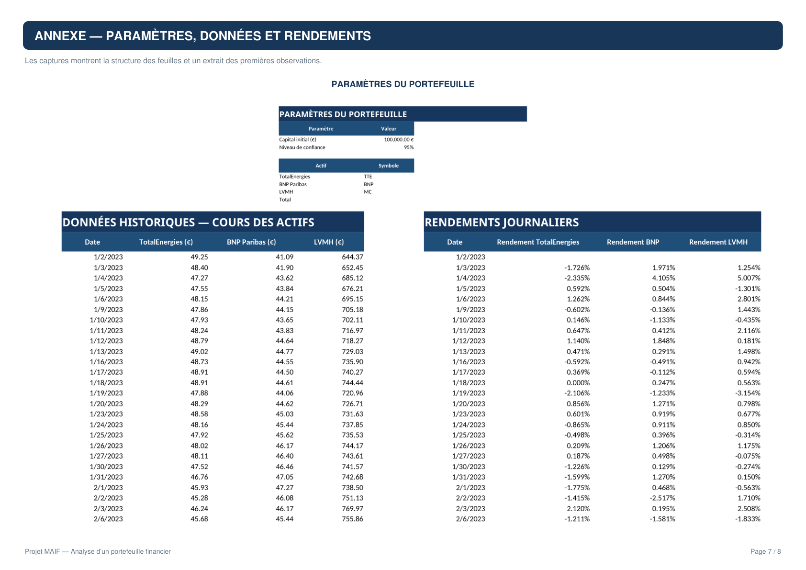
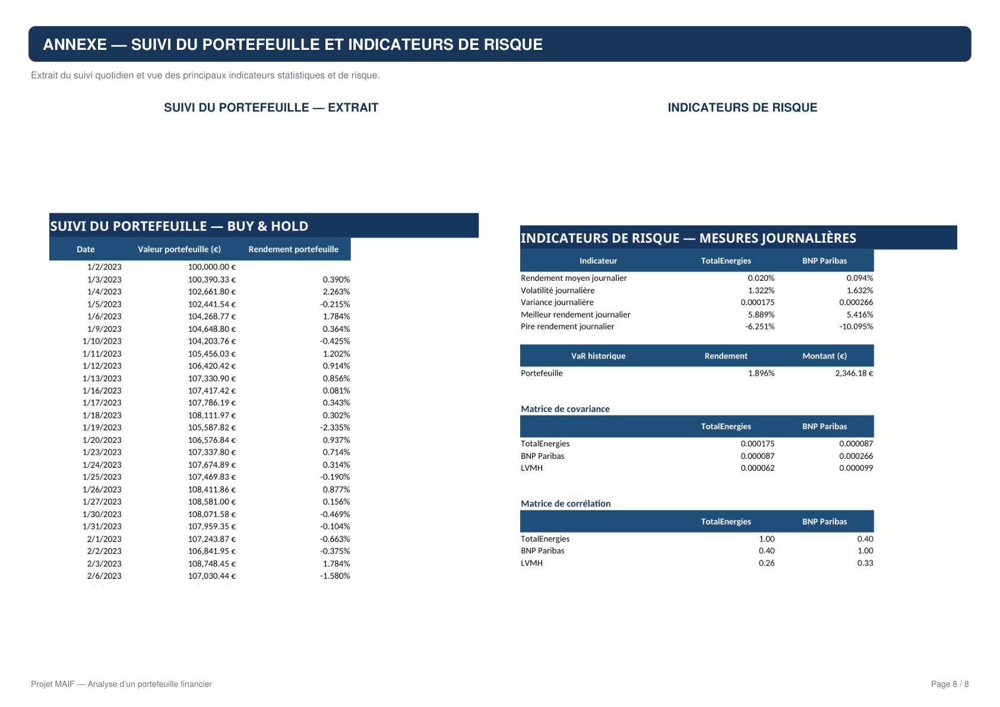

# Excel/VBA Portfolio Risk Dashboard

Interactive Excel/VBA tool for analysing the performance and market risk of a three-stock equity portfolio.



## Project overview

This academic project was developed as part of the **M1 – Applied Mathematics for Financial Engineering** programme at CY Cergy Paris Université.

The workbook analyses historical daily adjusted closing prices from Yahoo Finance for three CAC 40 stocks:

- TotalEnergies
- BNP Paribas
- LVMH

The study period runs from **2 January 2023 to 31 December 2025**, with **766 common observations** for the three assets. The portfolio starts with **€100,000**, allocated 35% to TotalEnergies, 25% to BNP Paribas and 40% to LVMH. It follows a **Buy and Hold** strategy: the initial quantities are held constant, without rebalancing.

## Main features

- Organisation of historical market data and daily asset returns.
- Calculation of initial invested amounts and theoretical quantities held.
- Daily portfolio valuation, returns and gains/losses.
- Descriptive statistics, variance and volatility.
- Historical Value at Risk (VaR) at the 95% confidence level.
- Drawdown and maximum drawdown analysis.
- Covariance and correlation matrices.
- VBA macros to add observations and update calculations and dashboard charts.
- Excel dashboard with financial indicators and visualisations.

## Selected results

Results reported in the project report for the historical sample:

| Indicator | Result |
|---|---:|
| Initial capital | €100,000.00 |
| Final portfolio value | €123,756.43 |
| Total gain | +€23,756.43 |
| Cumulative performance | +23.76% |
| Daily volatility | 1.19% |
| Historical VaR (95%) | 1.90% |
| VaR amount | €2,346.18 |
| Maximum drawdown | −23.83% |

The historical VaR is an estimate based on past returns, not a guaranteed maximum loss. Historical performance does not predict future results.

## Repository structure

```text
excel-vba-portfolio-risk/
├── workbook/
│   └── portfolio_risk_dashboard.xlsm
├── report/
│   └── project_report.pdf
├── presentation/
│   └── PowerPoint de soutenance
├── screenshots/
│   ├── dashboard.png
│   ├── data_and_returns.png
│   └── portfolio_and_risk.png
└── README.md
```

## Screenshots

### Dashboard
Main indicators, portfolio value history, initial allocation and asset performance.


### Historical data and daily returns
Portfolio parameters, adjusted closing prices and daily returns for the three stocks.



### Portfolio tracking and risk indicators
Portfolio valuation history, risk statistics, historical VaR, covariance and correlation matrices.



## Tools and methods

- **Microsoft Excel**: data organisation, dashboard and charts.
- **VBA**: automation of data entry, calculations and dashboard updates.
- **Financial mathematics and statistics**: returns, portfolio valuation, volatility, VaR, drawdown, covariance and correlation.
- **Yahoo Finance**: historical adjusted closing-price data source.

## How to use

1. Download the Excel workbook from the `workbook/` folder.
2. Open it in the desktop version of Microsoft Excel.
3. Enable macros if prompted and if you trust the workbook.
4. Use the **Add data** form to enter a new observation.
5. Click **Update dashboard** to recalculate the returns, portfolio valuation, risk indicators and charts.

The workbook is macro-enabled (`.xlsm`). Its VBA functionality may not work in Excel for the web or in spreadsheet applications that do not support VBA.

## Disclaimer

This is an academic portfolio-risk analysis project, not investment advice. Historical observations and risk estimates do not guarantee future performance or losses.

## Author

**Mame Thierno Thiam**  
M1 – Applied Mathematics for Financial Engineering  
CY Cergy Paris Université
